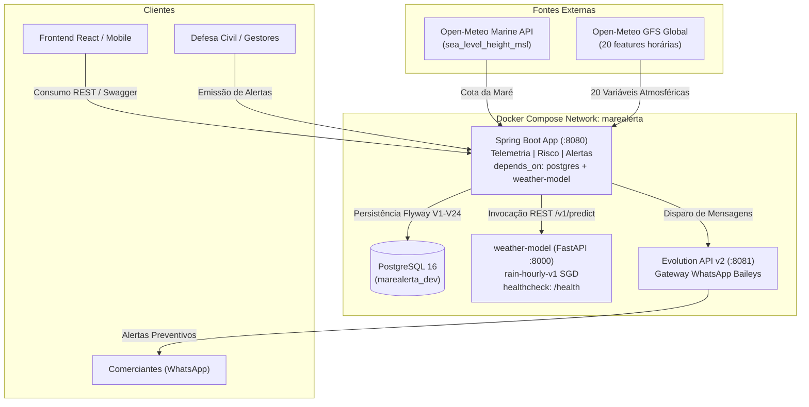

# Maré Alerta — Backend & Plataforma de Inteligência Preditiva

[](https://www.oracle.com/java/)
[](https://spring.io/projects/spring-boot)
[](https://www.postgresql.org/)
[](https://fastapi.tiangolo.com/)
[](https://flywaydb.org/)
[](https://www.docker.com/)
[]()

Backend oficial da plataforma **Maré Alerta**, desenvolvido para mitigar danos causados por alagamentos fluviais, ressacas e marés astronômicas na bacia hidrográfica de Belém/PA. O ecossistema combina **telemetria marinha e atmosférica 100% real**, **inferência de Machine Learning** e **notificações automatizadas via WhatsApp** para proteger comércios e cidadãos em áreas de cota crítica.

---

## 🌊 Visão Geral do Projeto

A cidade de Belém/PA convive com dinâmicas hidrológicas complexas: marés de sizígia que elevam o Rio Guamá e a Baía do Guajará a cotas superiores a 3,0 metros, frequentemente coincidentes com chuvas convectivas equatoriais de alta intensidade. Quando esses dois fenômenos coincidem, canais transbordam e vias comerciais críticas (como Ver-o-Peso, Doca de Souza Franco, Tamandaré e Estrada Nova) sofrem alagamentos severos.

O **Maré Alerta** atua como uma esteira preditiva e operacional completa:
1. **Ingestão em Tempo Real:** Captura dados marinhos e meteorológicos ao vivo de APIs especializadas (**Open-Meteo Marine & Forecast GFS**), sem valores matemáticos simulados.
2. **Predição por Inteligência Artificial:** Microserviço dedicado (`weather-model`) rodando um modelo SGD Classifier calibrado (`rain-hourly-v1`), processando 20 variáveis atmosféricas para prever chuva com horizonte de 1 hora.
3. **Cálculo de Risco Combinado:** Cruza a cota da maré (em metros) com a probabilidade de precipitação calculada pela IA, classificando o cenário em `BAIXO`, `MEDIO` ou `ALTO`.
4. **Alerta Preventivo via WhatsApp:** Notifica comerciantes cadastrados por bairro através da Evolution API v2 com antecedência ao pico da maré (*preamar*).
5. **Ações de Mitigação e Checklist:** Oferece checklists preventivos para elevação de itens críticos (freezers, maquinário, estoques) e registro oficial de sinistros pós-evento com fotos.

---

## 🏗️ Arquitetura dos Serviços (Docker Autocontido)

O ambiente é 100% orquestrado via `docker-compose.yml`, com build autocontido. O runtime do modelo preditivo de IA foi incorporado no diretório `docker/weather-model/`, permitindo que qualquer membro da equipe execute o projeto imediatamente após o `git clone`, sem precisar clonar repositórios externos.



### Contêineres Orquestrados:
- **`marealerta_pg` (PostgreSQL 16 Alpine):** Banco de dados relacional (3FN) com 24 migrações Flyway e schema isolado `evolution` para o WhatsApp.
- **`marealerta_ia` (FastAPI / Python 3.13):** Microserviço autocontido em `docker/weather-model/`, carregando o bundle `model_bundle.joblib` com montagem *read-only* e healthcheck ativo em `/health`.
- **`marealerta_whatsapp` (Evolution API v2):** Gateway multi-instâncias conectado ao WhatsApp via WebSockets.
- **`marealerta_app` (Spring Boot 4 / Java 21):** Aplicação principal, configurada com inicialização ordenada (`depends_on: { postgres: healthy, weather-model: healthy }`).

---

## 🌤️ Integrações Reais: Zero Mocks e Zero Simulações

Todos os dados artificiais (senóides matemáticas, probabilidades estáticas e fallbacks fictícios) foram eliminados da produção:

| Recurso | Fonte Anterior | Fonte Atual Oficial | Descrição |
| :--- | :--- | :--- | :--- |
| **Nível da Maré** | `2.0 + 1.2 * Math.sin(...)` | **Open-Meteo Marine API** | Cota real observada e horária (`sea_level_height_msl`) para a grade marinha de Belém. |
| **Tendência da Maré** | `"SUBINDO"` chumbado | **Diferencial de Previsão** | Compara a cota atual com a próxima hora de previsão (`SUBINDO`, `DESCENDO` ou `ESTAVEL`). |
| **Preamar (Horário do Pico)** | `.plusHours(2)` chumbado | **Janela Futura de 12 Horas** | Localiza dinamicamente o timestamp de maior cota prevista nas próximas 12h. |
| **Variáveis Atmosféricas da IA** | 15 valores fixos no código | **Open-Meteo GFS Global** | Consulta ao vivo de todas as **20 variáveis horárias** UTC exigidas pelo modelo de ML. |
| **Predição de Chuva** | Probabilidades falsas (0.85/0.50) | **weather-model (FastAPI)** | Inferência real via SGD Classifier, calculando probabilidade e precipitação esperada. |

### As 20 Variáveis Atmosféricas Consumidas em Tempo Real:
1. `temperature_2m` (°C)
2. `relative_humidity_2m` (%)
3. `dew_point_2m` (°C)
4. `pressure_msl` (hPa)
5. `surface_pressure` (hPa)
6. `cloud_cover` (%)
7. `cloud_cover_low` (%)
8. `cloud_cover_mid` (%)
9. `cloud_cover_high` (%)
10. `wind_speed_10m` (km/h)
11. `wind_direction_10m` (°)
12. `wind_gusts_10m` (km/h)
13. `cape` (J/kg)
14. `relative_humidity_850hPa` (%)
15. `relative_humidity_700hPa` (%)
16. `relative_humidity_500hPa` (%)
17. `temperature_850hPa` (°C)
18. `temperature_700hPa` (°C)
19. `geopotential_height_500hPa` (m)
20. `precipitation` (mm)

---

## 📡 Catálogo Completo de Endpoints REST

A documentação interativa com Swagger UI está acessível em `http://localhost:8080/swagger-ui/index.html`.

### 1. Autenticação e Conta (`/auth`)
- `POST /auth/registro`: Etapa 1 do onboarding comercial (criação de usuário e perfil inicial). Aceita chaves em português ou inglês.
- `POST /auth/login`: Autenticação via e-mail e senha com retorno de access token JWT (Bearer).
- `POST /auth/refresh`: Renovação segura de access token via refresh token.

### 2. Estabelecimentos Comerciais (`/estabelecimento`)
- `GET /estabelecimento`: Listagem de estabelecimentos comerciais ativos (Requer autenticação).
- `GET /estabelecimento/me`: Consulta do perfil comercial associado ao usuário logado.
- `GET /estabelecimento/{id}`: Busca detalhada de estabelecimento por identificador.
- `PUT /estabelecimento/{id}`: Etapa 2 do onboarding comercial (atualização de endereço estruturado, dias/horários de funcionamento e itens críticos).

### 3. Itens Críticos em Risco (`/itemcritico`)
- `POST /itemcritico/registrar`: Cadastro de bens vulneráveis à cota de alagamento (freezers, maquinário, estoques no chão).
- `GET /itemcritico/listar?estabelecimentoId={id}`: Listagem de itens críticos de um comércio.
- `GET /itemcritico/{id}`: Consulta de item crítico por ID.
- `PUT /itemcritico/{id}`: Atualização de nome e descrição de proteção do item.
- `DELETE /itemcritico/{id}`: Exclusão de item crítico.

### 4. Checklist Preventivo (`/checklists`)
- `POST /checklists/registrar`: Cadastro de tarefa preventiva (ex: "Desligar disjuntor geral", "Subir freezer 40cm").
- `GET /checklists/listar?estabelecimentoId={id}`: Listagem de tarefas ordenadas por prioridade.
- `GET /checklists/{id}`: Busca de tarefa de checklist por ID.
- `PUT /checklists/{id}`: Atualização de status da tarefa (`PENDENTE`, `EM_ANDAMENTO`, `CONCLUIDO`).
- `DELETE /checklists/{id}`: Exclusão de tarefa de checklist.

### 5. Telemetria Hidrometeorológica (`/telemetria`)
- `GET /telemetria/dashboard`: Dados ambientais consolidados da estação de Belém (cota da maré, tendência, chuva, vento, preamar previsto e nível de risco).
- `GET /telemetria/grafico`: Série temporal de leituras para renderização no componente visual `TideChart`.
- `GET /telemetria/historico?estacaoCodigo={codigo}`: Últimas 10 leituras observadas.
- `POST /telemetria/sincronizar`: Disparo manual da sincronização em tempo real contra as APIs Open-Meteo e Marine.
- `POST /telemetria/manual`: Inserção manual de leitura técnica por operadores.

### 6. Análise de Risco e Inteligência Artificial (`/risco`)
- `GET /risco/atual?localidade={bairro}`: Orquestra a coleta de telemetria, busca das 20 variáveis GFS, predição do modelo de IA e classificação de risco final (`BAIXO`, `MEDIO`, `ALTO`).

### 7. Alertas e Notificações (`/alertas`)
- `GET /alertas`: Listagem de alertas públicos emitidos pela Defesa Civil.
- `POST /alertas`: Criação de novo comunicado de emergência com opção de disparo automático via WhatsApp por bairro.

### 8. Ocorrências e Sinistros (`/ocorrencias`)
- `POST /ocorrencias`: Registro de sinistro pós-alagamento com protocolo sequencial único e estimativa de prejuízo.
- `POST /ocorrencias/{id}/fotos`: Upload de comprovantes e fotos da ocorrência em formato multipart.

---

## 🗄️ Modelo de Dados & Migrações Flyway (V1 a V24)

O banco de dados é estruturado na **3ª Forma Normal (3FN)** com índices B-Tree, constraints estritas de integridade relacional e índices parciais para soft delete:

- **V1 a V6:** Criação de `estabelecimento`, `usuario`, `estabelecimento_horarios`, `alerta`, `ocorrencias` e soft delete.
- **V7 a V10:** Criação de `itens_criticos`, ajustes em sinistros e correções de índices.
- **V11 a V14:** Endereço comercial estruturado, `itens_checklist` e `ocorrencia_fotos`.
- **V15 a V18:** Criação e expansão de `leituras_telemetria`, normalização de bairros e índice único de e-mail ativo.
- **V19:** Tabela `previsoes_chuva_ml` para histórico e auditoria de previsões do modelo de Machine Learning.
- **V20:** Tabela `envios_alerta_whatsapp` com fila, status e auditoria de mensagens enviadas.
- **V21:** Limpeza de colunas legadas e adição de índices compostos (`idx_ocorrencias_status_data`).
- **V22:** Endurecimento com constraints `CHECK` para todos os Enums e valores não negativos.
- **V23:** Adição da coluna `fonte` em `leituras_telemetria` (`OPEN_METEO`, `TABUA_MARE`) com restrição de unicidade idempotente `uq_telemetria_chave`.
- **V24:** Índice funcional case-insensitive `LOWER(email)` para prevenir duplicidades de cadastro.

---

## 🚀 Como Executar o Projeto

### Pré-requisitos
- **Docker** e **Docker Compose** (recomendado para execução completa de todos os serviços).
- **Java 21** (JDK 21 LTS) e **Gradle** (caso deseje rodar a aplicação Spring Boot no host).
- **Git**.

---

### Opção 1: Execução 100% via Docker Compose (Recomendado)

Esta é a maneira mais simples e recomendada para subir o ambiente completo (Postgres, IA, WhatsApp e Backend) com um único comando:

1. **Clone o repositório:**
   ```bash
   git clone https://github.com/MonkeyCodeUnama/mare-alerta-backend.git
   cd mare-alerta-backend
   ```

2. **Configure o arquivo de ambiente:**
   ```bash
   cp .env.example .env
   ```
   > O arquivo `.env` já vem pré-configurado com credenciais de desenvolvimento seguras e `IA_BUILD_CONTEXT=./docker/weather-model`.

3. **Inicie todos os serviços com build:**
   ```bash
   docker compose up -d --build
   ```

4. **Verifique o status de saúde dos contêineres:**
   ```bash
   docker compose ps
   ```
   Todos os contêineres devem reportar `healthy` ou `running`:
   - `marealerta_pg` (Porta 5432)
   - `marealerta_ia` (Porta 8000)
   - `marealerta_whatsapp` (Porta 8081)
   - `marealerta_app` (Porta 8080)

5. **Acompanhe os logs em tempo real:**
   ```bash
   docker compose logs -f app
   ```

---

### Opção 2: Execução Híbrida (Infraestrutura no Docker + Backend no Host)

Ideal para desenvolvimento ativo no código Java com reinicialização rápida via Gradle:

1. **Inicie a infraestrutura de apoio (PostgreSQL, IA e WhatsApp):**
   ```bash
   docker compose up -d postgres weather-model evolution_api
   ```

2. **Execute o backend via Gradle:**
   - **No Windows (PowerShell):**
     ```powershell
     ./gradlew bootRun
     ```
   - **No Linux / macOS:**
     ```bash
     ./gradlew bootRun
     ```

3. As migrações do Flyway (`V1` a `V24`) serão executadas automaticamente ao inicializar o Spring Boot.

---

## 🧪 Testes Automatizados

O projeto possui uma suíte abrangente de **115 testes automatizados** cobrindo controladores REST, regras de negócio de serviços, validações de segurança e clientes HTTP externos:

```powershell
./gradlew test
```

### Cobertura da Suíte:
- **Autenticação & Segurança:** Ciclo de login, registro, emissão/renovação de JWT e Rate Limiting por IP (`RateLimitFilterTest`, `AuthServiceTest`, `AuthControllerTest`, `JwtServiceTest`).
- **Telemetria:** Ingestão de dados Open-Meteo, cálculo de tendências, pico de preamar e pontos para o gráfico (`TelemetriaServiceTest`, `TelemetriaControllerTest`, `OpenMeteoClientTest`).
- **Predição & Risco:** Resolução das 20 features GFS, integração com `weather-model`, matriz de risco e auditoria em banco (`RiscoServiceTest`, `RiscoControllerTest`, `MlApiClienteTest`).
- **Itens Críticos & Checklists:** CRUD de bens em risco e tarefas preventivas (`ItemCriticoServiceTest`, `ItemCriticoControllerTest`, `ChecklistServiceTest`, `ChecklistControllerTest`).
- **Alertas & WhatsApp:** Envio de alertas, validação de números E.164 e persistência de histórico (`AlertaServiceTest`, `AlertaControllerTest`, `EvolutionApiClientTest`).
- **Ocorrências:** Registro de sinistros e upload de arquivos (`OcorrenciaServiceTest`, `OcorrenciaControllerTest`).
- **Integração End-to-End:** Validação com Flyway e PostgreSQL (`BackendApplicationTests`).

---

## 🔗 Portas e URLs de Acesso

| Serviço | URL | Descrição |
| :--- | :--- | :--- |
| **API Backend (Swagger UI)** | `http://localhost:8080/swagger-ui/index.html` | Interface interativa de testes OpenAPI 3 |
| **OpenAPI Schema JSON** | `http://localhost:8080/v3/api-docs` | Especificação completa da API |
| **Microserviço IA (FastAPI Docs)** | `http://localhost:8000/docs` | Documentação Swagger do modelo preditivo |
| **Healthcheck da IA** | `http://localhost:8000/health` | Verificação de integridade e carregamento do modelo |
| **Painel WhatsApp (Evolution API)** | `http://localhost:8081/manager` | Painel de gestão de instâncias e conexão QR Code |
| **Banco PostgreSQL** | `localhost:5432` | Banco de dados `marealerta_dev` |

---

## 📁 Estrutura do Repositório

```
mare-alerta-backend/
├── docker/
│   └── weather-model/                 # Runtime autocontido do modelo preditivo de IA
│       ├── Dockerfile                 # Contêiner Python 3.13-slim
│       ├── requirements.txt           # Dependências (FastAPI, scikit-learn, joblib)
│       ├── app.py                     # API FastAPI (/health, /v1/predict)
│       ├── rain_runtime.py            # Pipeline de inferência SGD
│       └── artifacts/                 # model_bundle.joblib e metadata.json
├── docs/                              # Documentação técnica aprofundada
│   ├── GUIA_BACKEND.md                # Guia de arquitetura viva e histórico de commits
│   └── IA_PREVISAO_CHUVA_BACKEND.md   # Especificação das features climáticas
├── src/
│   ├── main/
│   │   ├── java/com/marealerta/backend/
│   │   │   ├── alerta/                # Gestão e despacho de alertas
│   │   │   ├── auth/                  # Segurança, JWT e usuários
│   │   │   ├── checklist/             # Checklists de prevenção
│   │   │   ├── estabelecimento/       # Cadastro de comércios e horários
│   │   │   ├── itens/                 # Itens críticos em cota de risco
│   │   │   ├── ocorrencias/           # Sinistros e upload de fotos
│   │   │   ├── risco/                 # Predição ML e matriz de risco
│   │   │   ├── shared/                # Filtros de Rate Limit e segurança
│   │   │   └── telemetria/            # Ingestão Open-Meteo e cota marinha
│   │   └── resources/
│   │       ├── db/migration/          # Migrações Flyway (V1 a V24)
│   │       ├── application.yaml       # Configuração base
│   │       └── application-prod.yaml  # Configuração de produção
│   └── test/                          # 115 testes unitários e de integração
├── docker-compose.yml                 # Orquestração completa dos 4 contêineres
├── Dockerfile                         # Build multi-stage da aplicação Spring Boot
├── build.gradle.kts                   # Configuração de build Gradle Kotlin DSL
├── .env.example                       # Modelo de variáveis de ambiente
└── README.md                          # Documentação principal
```

---

## 👥 Autores e Contribuição

Desenvolvido pela equipe de engenharia do **Maré Alerta** na **Unama / MonkeyCode**:
- Arquitetura, Backend e Integração: Daniel das Neves (`AKIRA-NZR`)
- Machine Learning & Modelo Meteorológico: Equipe de IA Maré Alerta
- Integração Frontend & Mobile: Equipe Frontend Maré Alerta
